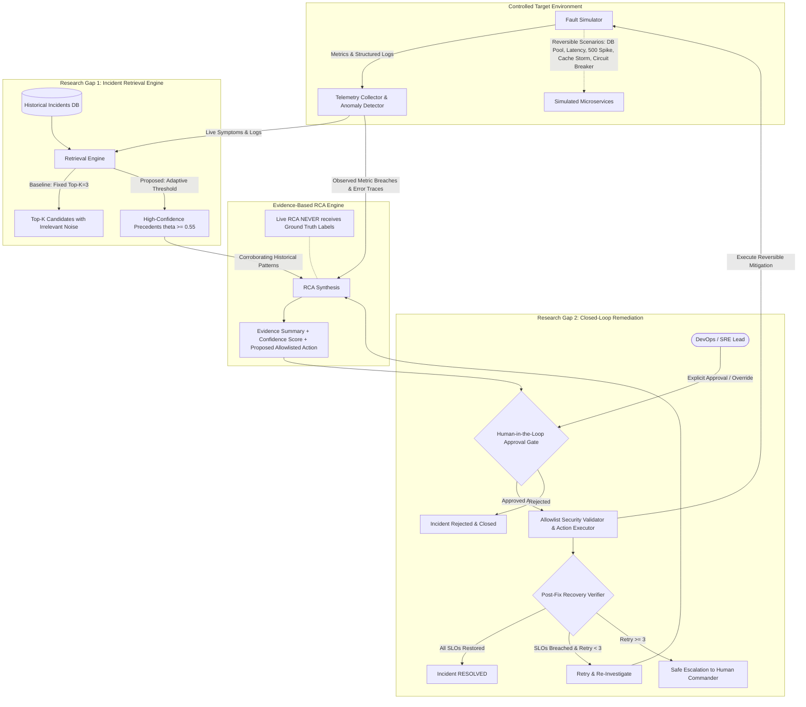
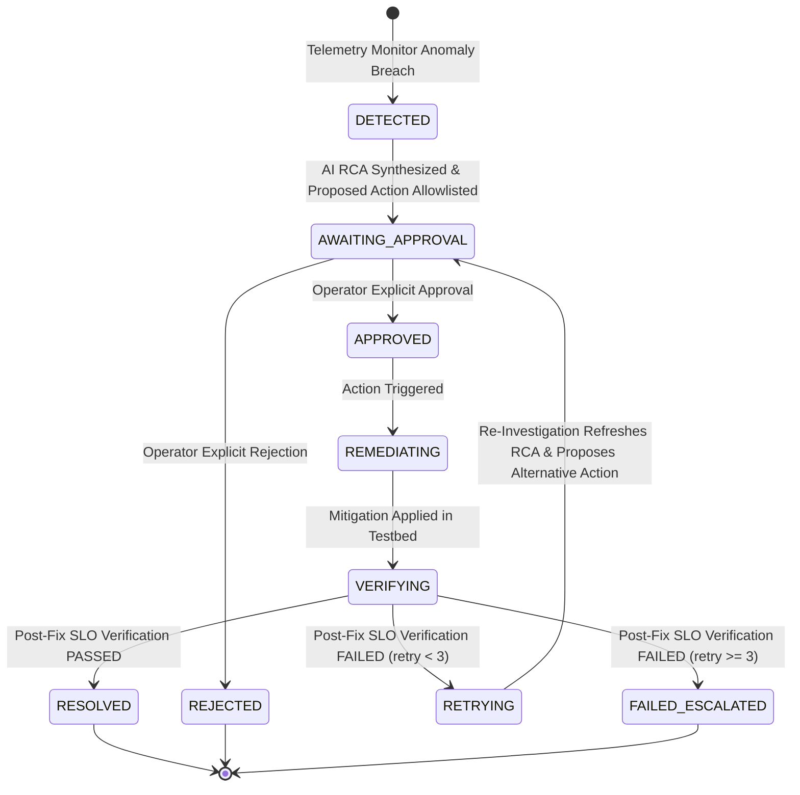

# System Architecture

## Project Title
**AI-Based Production Incident Investigator with Adaptive Root Cause Analysis and Closed-Loop Resolution**

---

## 1. Architectural Overview

The AI Production Incident Investigator is a research platform designed to investigate production software failures and execute safe, closed-loop automated resolutions. It addresses two foundational research challenges in automated SRE operations:
1. **Adaptive Historical Incident Retrieval**: Preventing irrelevant historical incidents from contaminating root-cause reasoning by replacing fixed Top-K retrieval with relevance-threshold filtering.
2. **Controlled Closed-Loop Remediation**: Ensuring autonomous remediation operates with human-in-the-loop validation, strict allowlist security gates, post-execution SLO verification, and bounded retry loops.

---

## 2. Core Architectural Components

### 2.1 Reversible Controlled Fault Simulator (`fault_simulator.py`)
- Emulates realistic microservice failure modes without inflicting real host-level damage or non-reversible state mutation.
- **Implemented Failure Scenarios**:
  1. `database_connection_exhaustion` (checkout-service): 100% pool saturation, `QueuePool` timeout exceptions.
  2. `high_latency_cascade` (payment-gateway): Downstream 15s timeout, thread backlog starvation.
  3. `service_error_spike` (inventory-api): Null pointer schema mismatch, HTTP 500 error cascade.
  4. `cache_invalidation_storm` (catalog-service): Synchronized cache key expiration, database query overload.
  5. `circuit_breaker_trip` (recommendation-service): Downstream crash tripping circuit breaker to OPEN state.
- **Controlled State Management**: In-memory active fault state tracking with real-time metric perturbation and instant reset capabilities.

### 2.2 Telemetry Service & Anomaly Detector (`telemetry_service.py`)
- Monitors continuous metric feeds against Service Level Objectives (SLOs):
  - HTTP Error Rate: $> 2.0\%$ threshold
  - P99 Latency: $> 500\text{ ms}$ threshold
  - DB Connection Pool Utilization: $> 80\%$ threshold
  - Circuit Breaker State: $\ne \text{"CLOSED"}$
  - Cache Hit Ratio: $< 60\%$ threshold
- Formats structured event payloads containing timestamps, log severity levels, and culprit service tags.

### 2.3 Retrieval Engine (`retrieval_engine.py`)
- Represents incident cases using TF-IDF sublinear vectorization combined with n-gram token overlap scoring and contextual service affinity bonuses.
- Implements two competing retrieval strategies:
  - **Baseline (Fixed Top-K = 3)**: Unconditionally returns the top 3 documents ranked by cosine similarity, regardless of absolute score.
  - **Proposed (Adaptive Threshold $\theta = 0.55$)**: Enforces a strict relevance floor $\theta$. Filters out candidates failing the threshold and dynamically truncates score drop-offs, returning 0 candidates for novel incidents to avoid hallucination.
- Houses the mathematical evaluation engine calculating Precision, Recall, F1, retrieval counts, and irrelevant noise reduction.

### 2.4 Evidence-Based RCA Engine (`rca_engine.py`)
- **Strict Separation of Concerns**: Live RCA inputs only receive observed symptoms, telemetry metrics, and log excerpts. Ground-truth evaluation labels are never accessible to this module.
- Correlates live breaches with retrieved historical precedent cases.
- Computes:
  - Culprit Service Identification
  - Evidence Itemization (metric breaches and log stack traces)
  - Calibrated Confidence Score ($0.0 - 1.0$)
  - Allowlisted Remediation Action Recommendation

### 2.5 Safe Allowlisted Remediation & Approval Gate (`allowlist.py`, `remediation_service.py`)
- **Strict Allowlist**: Only pre-registered, idempotent, and reversible actions can be executed:
  - `restart_connection_pool`: Connection drainage and pool recycle.
  - `rate_limit_throttle`: Dynamic ingress throttling.
  - `rollback_config_flag`: Feature/schema flag rollback.
  - `flush_and_warm_cache`: Cache key flush with staggered TTL jitter.
  - `reset_circuit_breaker`: Circuit breaker probe reset.
  - `scale_worker_replicas`: Horizontal container replica increment.
- **Human-in-the-Loop Gate**: Incident status transitions to `AWAITING_APPROVAL`. Execution is blocked until an authorized operator submits an explicit approval payload.

### 2.6 Recovery Verifier & Safe Retry State Machine (`recovery_verifier.py`)
- Following action execution, the verifier collects fresh post-remediation telemetry.
- Evaluates recovery across all SLO dimensions.
- If verified: marks incident `RESOLVED`.
- If verification fails:
  - Enters `RETRYING` state.
  - Increments `retry_count`.
  - Re-triggers the RCA engine to analyze residual symptoms and recommend secondary mitigation.
  - Once `retry_count >= max_retries` (default 3), halts autonomous execution and transitions to `FAILED_ESCALATED` to alert human on-call engineers.

---

## 3. Technology Stack & Design Decisions

| Component | Technology | Rationale |
|---|---|---|
| Backend Framework | FastAPI (Python 3.11+) | Asynchronous, auto-documenting OpenAPI/Swagger, high throughput |
| Data Layer | SQLAlchemy + SQLite | Zero external setup requirement; fully reproducible locally |
| Retrieval & NLP | scikit-learn (TF-IDF + Cosine) | Fast, deterministic, reproducible, requires no paid API keys |
| Frontend Framework | React 19 + Vite | Fast HMR, reactive dashboard, production bundle optimization |
| Styling | Modern CSS3 Glassmorphism | Dark observability theme, responsive grid, micro-animations |
| Automated Testing | pytest + Starlette TestClient + httpx | 35 comprehensive automated tests covering all requirements |

---

## 4. Incident State Machine & Transition Invariants

### State Machine Transition Rules
1. **Approval Enforcement**: Incidents cannot transition from `AWAITING_APPROVAL` directly to `REMEDIATING`. Only `APPROVED` or `RETRYING` incidents may execute.
2. **Replay & Concurrency Prevention**: If an incident is in `REMEDIATING` or `VERIFYING`, subsequent execution calls are blocked with a `ValueError`.
3. **Immutability of Terminal States**: Once an incident reaches `RESOLVED`, `REJECTED`, or `FAILED_ESCALATED`, approval or execution is permanently blocked to prevent invalid state corruption.
4. **Bounded Retry Guarantee**: Every failed verification strictly increments `retry_count`. When `retry_count >= max_retries` (default 3), the state transitions to `FAILED_ESCALATED` to prevent infinite remediation loops.

---

## 5. Execution Boundary: Real vs Simulated Controls

To preserve academic integrity and avoid deceptive claims:
- **What is Truly Executed**:
  - The entire FastAPI backend and RESTful endpoints run live.
  - The TF-IDF vectorization, token coverage calculation, and cosine ranking execute live.
  - SQLite database ORM transactions, schema validation, and audit logs persist live.
  - The React frontend dashboard compiles via Vite and communicates with the backend via live HTTP proxies.
  - The 35 automated pytest integration suites execute real assertions.
- **What is Controlled / Simulated**:
  - Remediations (`restart_connection_pool`, `flush_and_warm_cache`, etc.) execute against the controlled in-memory microservice testbed (`fault_simulator.py`).
  - They reset active fault flags and restore simulated telemetry streams.
  - **No root shell commands, OS container termination, or production database drops are executed on the host system.**

---

## 6. Academic Review Defense (Key Review Questions Answered)

### Q1: Why use ShopEase when the research is not about e-commerce?
**Answer**: ShopEase serves as a representative microservice topology (checkout, payment, catalog, inventory, recommendation) exhibiting standard distributed dependencies (databases, external webhooks, caches, worker queues, circuit breakers). The research contributions—adaptive precedent retrieval and closed-loop allowlisted remediation—are domain-agnostic and apply to any cloud-native service mesh.

### Q2: What exactly are the two research gaps?
**Answer**: 
1. *Retrieval Noise*: Fixed Top-K retrieval ($K=3$ or $K=5$) forces irrelevant past incident cases into prompt/RCA context whenever a problem has fewer than $K$ true matches or is novel, inducing hallucinations.
2. *Uncontrolled Remediation*: Open-loop automated remediation lacks human-in-the-loop approval, strict allowlist gates, and independent multi-SLO recovery verification with bounded retries.

### Q3: What is the proposed contribution beyond existing RCA approaches?
**Answer**: A unified, reproducible system combining:
- Relevance-threshold adaptive historical retrieval ($\theta=0.55$) that guarantees zero-noise retrieval on novel incidents.
- A controlled closed loop that enforces backend allowlisting, human-in-the-loop approval, independent multi-SLO recovery verification, and bounded retry/escalation.

### Q4: How does adaptive retrieval differ from fixed Top-K?
**Answer**: Fixed Top-K returns exactly $K$ documents regardless of score. Adaptive retrieval enforces a minimum relevance threshold ($\theta=0.55$) and dynamic score drop-off truncation ($\Delta \le 0.35$), returning 0 cases for novel incidents.

### Q5: How are precision, recall, and F1 calculated?
**Answer**: $TP = |R \cap G|$, $FP = |R \setminus G|$, $FN = |G \setminus R|$. When $|R|=0$ and $|G|=0$, $P=1.0, R=1.0, F_1=1.0$ (perfect noise suppression). When $|R|=0$ and $|G|>0$, $P=0.0, R=0.0, F_1=0.0$. Otherwise, $P = TP/(TP+FP)$, $R = TP/(TP+FN)$, $F_1 = 2PR/(P+R)$.

### Q6: How do you prevent ground-truth leakage?
**Answer**: Ground-truth labels are completely isolated within `eval_labeled_dataset.json`. The live RCA engine (`rca_engine.py`) and live telemetry service have no access to ground-truth labels.

### Q7: How does the system verify recovery?
**Answer**: `recovery_verifier.py` checks actual telemetry against 5 SLO thresholds (error rate $\le 2\%$, P99 latency $\le 500$ms, DB pool $\le 80\%$, circuit breaker closed, cache hit $\ge 60\%$) and confirms target service fault clearance rather than superficial HTTP 200 responses.

### Q8: What happens after an ineffective fix?
**Answer**: If an approved action does not resolve the active fault, the fault remains active and verification fails. The incident remains OPEN in `AWAITING_APPROVAL`, increments `retry_count`, re-investigates with fresh evidence, and proposes an alternative corrective action.

### Q9: Which actions are truly executed and which are simulated?
**Answer**: Actions mutate the in-memory state of the microservice testbed (`fault_simulator.py`), resetting connection pools, clearing queues, and updating cache states. We explicitly disclose that actions are executed against this controlled simulator rather than bare-metal production hosts.

### Q10: What dataset was actually used?
**Answer**: A 15-query labeled benchmark dataset (`data/eval_labeled_dataset.json`) and 12-case repository (`data/historical_incidents.json`), supplemented by a verified Kaggle AIOps Failure Detection dataset schema sample (`data/sample_kaggle_aiops.csv`).

### Q11: What are the limitations of the experiments?
**Answer**: Evaluated on a 15-query curated benchmark; large enterprises possess thousands of cases. Uses deterministic TF-IDF + token overlap rather than dense neural embeddings to ensure zero paid API dependencies and 100% local reproducibility.

### Q12: What evidence supports the reported improvement?
**Answer**: Independently verified by automated test suites (35 tests passing) and freshly generated benchmark outputs (`data/last_experiment_results.csv` and `.json`), demonstrating +60.00% precision improvement and 100.0% reduction in irrelevant noise.

